<p align="center"></p>

<h1 align="center">Claudinho na barra de menu</h1>

<p align="center">
O Claudinho chef mora na barra de menu do Mac: ele mostra o que o Claude Code está cozinhando agora<br>
e quanto da sua janela de uso já foi pro fogo. Sem Kindle, sem servidor, sem Python obrigatório.
</p>

<p align="center">
  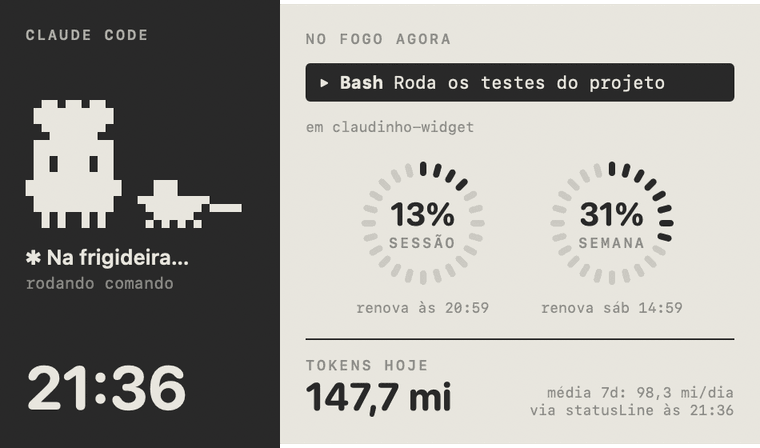
</p>

<p align="center"><sub>Telas geradas pelo próprio app em modo demo (<code>./build.sh --preview</code>).</sub></p>

> **Ideia original:** [kindle-claude](https://github.com/guithepc/kindle-claude), de **Guilherme Pessoa** ([@guithepc](https://github.com/guithepc) · @pctheonee), que transformou um Kindle velho num painel do Claude Code com o Claudinho chef. Este projeto é uma releitura dele pra barra de menu do Mac. Veja os [créditos](#créditos).

## O que é

Na barra de menu fica o Claudinho animado e o % da sessão:

<p align="center">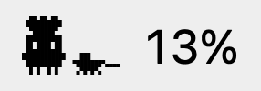</p>

Clicando nele abre um painel no estilo e-ink com:

- **O que está no fogo agora**: a ferramenta em uso (`Edit`, `Bash`, `Grep`…), o que ela está fazendo e em qual projeto.
- **Quanto da janela de uso já foi**: % da sessão de 5h e % da semana, em anéis segmentados, com a hora em que cada um zera.
- **Tokens de hoje** e a média diária dos últimos 7 dias.
- **O Claudinho chef**, um mascote em pixel art que muda de animação conforme o estado.

É uma releitura do [kindle-claude](https://github.com/guithepc/kindle-claude) pra quem não tem um Kindle sobrando: a mesma ideia e o mesmo clima de cozinha, só que num app nativo de ~38 MB que acompanha o uso ao vivo e fica parado quando você também está.

## Os estados

| Trabalhando | Pedindo permissão |
|---|---|
| 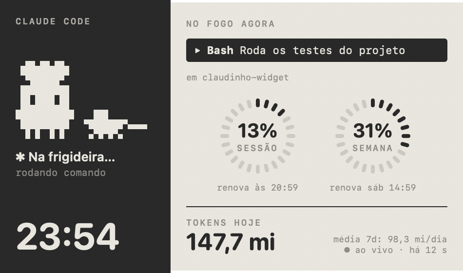 | 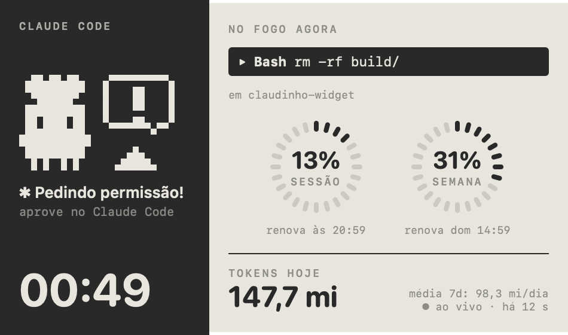 |
| O Claude está trabalhando. A barra "No fogo agora" mostra a ferramenta atual. | Uma sessão está parada esperando você aprovar uma ferramenta. Precisa dos hooks. |
| **Esperando você** | **Descansando** |
| 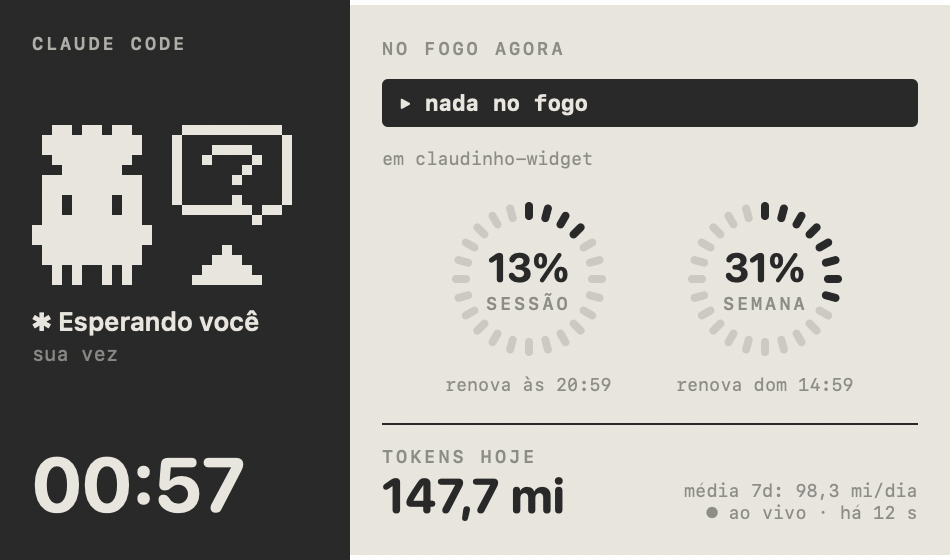 | 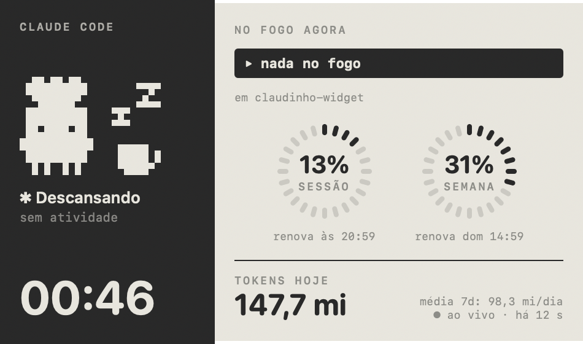 |
| Terminou e é a sua vez. | Nada aconteceu nos últimos 15 minutos. |

Com várias sessões abertas (app do Claude, terminal do IntelliJ, agentes em paralelo), o painel mostra a mais urgente: pedindo permissão > trabalhando > terminou > esperando.

## O Claudinho chef

Oito animações de 2 quadros cada, numa grade de 27×16 pixels: 12 colunas pro Claudinho e 14 pro utensílio. Cada animação conta o que o Claude está fazendo de verdade.

| | | | |
|:-:|:-:|:-:|:-:|
| 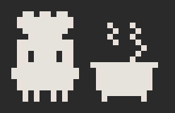 | 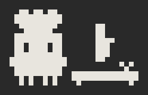 | 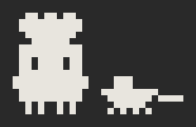 | 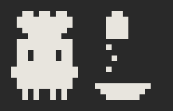 |
| Mexendo a sopa<br><sub>pensando</sub> | Cortando cebola<br><sub>`Edit` / `Write`</sub> | Frigideira<br><sub>`Bash`</sub> | Temperando<br><sub>`Read`, `Grep`, web…</sub> |
|  | 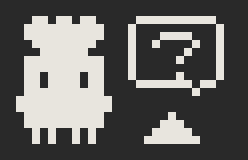 | 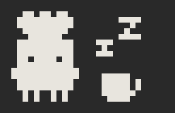 | |
| Prato pronto<br><sub>acabou de terminar</sub> | Sino com "?"<br><sub>sua vez (com "!" quando pede permissão)</sub> | Cochilando com café<br><sub>parado</sub> | |

No Kindle a animação precisou virar blocos sorteados, porque ele só olha a cada 30 s. Aqui a barra de menu atualiza na hora, então dá pra ter uma animação por tipo de ferramenta. O processo está em [docs/design.md](docs/design.md).

## Como funciona

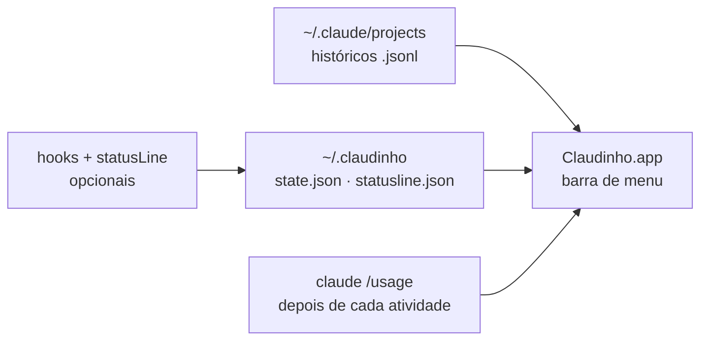

O % do limite só anda quando o Claude responde. Por isso o Claudinho é **ao vivo por evento**: ele lê o uso real logo depois de cada atividade, e parado não gasta nada.

1. **`/usage` real**: enquanto o Claude trabalha, o app roda `claude "/usage"` escondido (~1 s) a cada 60 s, e 15 s depois de cada resposta terminar. Sem atividade nova, não roda.
2. **statusLine** (opcional): quando o Claude Code manda o % exato, ele entra na hora. Leituras que andam pra trás são ignoradas, porque no app do Claude ela pode repetir um valor antigo.
3. **Históricos**: entre uma leitura e outra, o app soma os tokens dos `.jsonl` em `~/.claude/projects` a cada 3 s, com peso por tipo de token, e projeta o %.

O painel mostra de quando é o número ("ao vivo via /usage · há 12 s").

O estado (pensando, ferramenta, terminou) vem dos **hooks** quando estão ligados, e dos próprios históricos quando não estão. Detalhes em [docs/como-funciona.md](docs/como-funciona.md).

## Instalação

### O que você precisa

- **macOS 14 ou mais novo**, num Mac com Apple Silicon.
- **Xcode Command Line Tools** (`xcode-select --install`). Não precisa do Xcode inteiro.
- **Claude Code** rodando no mesmo Mac (app do Claude, terminal ou IntelliJ).
- **Python 3** só se for ligar os hooks. O que vem com as Command Line Tools serve.

### Passo a passo

```sh
git clone https://github.com/AlmeidaSNicolas/claudinho-widget.git
cd claudinho-widget
./install.sh              # compila, copia pra ~/Applications e abre no login
python3 setup.py          # opcional: liga hooks e statusLine (faz backup do settings.json)
cd .. && rm -rf claudinho-widget   # opcional: o repo não é mais necessário
```

O Claudinho aparece na barra de menu na hora. Se rodou o `setup.py`, reinicie as sessões do Claude Code que já estavam abertas.

> [!TIP]
> **Depois de instalado, você não precisa mais do repo na máquina e pode apagar a pasta.** O app roda de `~/Applications/Claudinho.app`, e o `setup.py` copia os hooks pra `~/.claudinho/hooks`. Só clone de novo quando quiser atualizar ou desinstalar.

| Onde fica | O quê |
|---|---|
| `~/Applications/Claudinho.app` | o app |
| `~/Library/LaunchAgents/local.claudinho.monitor.plist` | abre o app no login |
| `~/.claudinho/` | config, hooks copiados e o que eles gravam |
| `~/.claude/settings.json` | as entradas dos hooks e da statusLine (com backup ao lado) |

### Configuração

Fica em `~/.claudinho/config.json`, que o app cria e mantém sozinho:

| Opção | O que é | Padrão |
|---|---|---|
| `sessionLimitUnits` | quantas unidades ponderadas valem 100% da sessão | `18000000` |
| `weeklyLimitUnits` | idem pra semana | `67000000` |
| `liveProbeSeconds` | com o Claude trabalhando, de quantos em quantos segundos ler o `/usage` | `60` |
| `weekResetsAt` | um instante em que a semana renova (o ciclo se repete a cada 7 dias) | da primeira leitura |
| `calibration` | a última leitura real (`at`, `sessionPct`, `sessionResetsAt`, `weekPct`, `source`) | — |

Os limites se ajustam sozinhos a cada leitura real em que o % andou. Normalmente não precisa mexer.

## No dia a dia

| Ação | Como |
|---|---|
| Ver o painel | clicar no Claudinho na barra de menu |
| Ler o uso real agora | ⋯ → **Recalibrar agora** (lê o `/usage`) |
| Calibrar à mão | ⋯ → **Calibrar à mão…** e copiar os números do `/usage` |
| Sair | ⋯ → **Sair do Claudinho** (volta no próximo login) |
| Atualizar depois de mexer no código | `./install.sh` (e `python3 setup.py` se mexeu nos hooks) |
| Regenerar as imagens do README | `./build.sh --preview` |
| Regenerar o ícone do app | `./build.sh --icon` |
| Remover hooks e statusLine | `python3 setup.py remover` |
| Desinstalar o app | `./install.sh --uninstall` |
| Desinstalar sem o repo | `launchctl bootout gui/$UID/local.claudinho.monitor`, apagar os itens da tabela acima e tirar os hooks do `~/.claude/settings.json` |

Com a tampa fechada o Mac dorme, e o Claudinho junto. Quando acorda, ele atualiza na hora.

## Estrutura

```
claudinho-widget/
├── Sources/
│   ├── StatusBar.swift    ícone na barra de menu (AppKit) e o popover
│   ├── App.swift          Monitor (estado + calibração) e o painel em SwiftUI
│   ├── Usage.swift        leitura incremental dos .jsonl, janela de 5h e semana, config
│   ├── Hooks.swift        lê state.json e statusline.json gravados pelos hooks
│   ├── UsageProbe.swift   roda `claude /usage` num pseudo-terminal e extrai os números
│   └── Sprites.swift      o Claudinho chef em ASCII e o renderizador
├── hooks/
│   ├── hook.py            hook do Claude Code: estado de cada sessão
│   └── statusline.py      statusLine: guarda o % exato e repassa a sua statusLine antiga
├── tools/
│   ├── preview/           gera as imagens deste README em modo demo
│   └── icon/              gera o ícone do app a partir do sprite
├── Resources/AppIcon.icns o ícone do app
├── setup.py               liga/desliga hooks e statusLine no ~/.claude/settings.json (com backup)
├── build.sh               compila o .app (ou as imagens, com --preview)
├── install.sh             instala em ~/Applications e registra o LaunchAgent
└── docs/                  funcionamento, design, problemas e imagens
```

## Limitações

- Só enxerga o Claude Code rodando neste Mac. O uso no claude.ai (navegador ou celular) entra no seu limite, mas não nos históricos. A calibração pelo `/usage` ou pela statusLine é que corrige isso.
- Entre duas leituras reais (no máximo 60 s com o Claude trabalhando) o % é uma projeção pelos históricos.
- Cada leitura abre o Claude Code por ~1 s, com um pico de 200–400 MB que some logo depois. Dá pra espaçar com `liveProbeSeconds`.
- No app do Claude a statusLine roda, mas pode repetir um % antigo. Por isso o `/usage` automático continua valendo, e leituras que andam pra trás são ignoradas.
- O estado "pedindo permissão" só aparece com os hooks ligados.
- O `/usage` automático depende do texto da tela do Claude Code. Se ele mudar de formato, a leitura falha em silêncio e o app segue só com a estimativa.
- Compilado e testado só em Apple Silicon, no macOS 27.

Problemas encontrados no caminho e como resolver: [docs/problemas.md](docs/problemas.md).

## Créditos

Este projeto não existiria sem o **[kindle-claude](https://github.com/guithepc/kindle-claude)**, de **Guilherme Pessoa** ([@guithepc](https://github.com/guithepc) no GitHub, @pctheonee). Dele vêm:

- **a ideia**: um painel de mesa que mostra o que o Claude Code está fazendo e quanto do limite já foi;
- **o Claudinho chef** e o clima de cozinha: "no fogo agora", panelas, cebola, frigideira, sino, cochilo com café;
- **o layout do painel**: mascote no lado escuro, anéis de sessão e semana no lado claro, tokens do dia embaixo;
- **a arquitetura de hooks + statusLine**: `hooks/hook.py`, `hooks/statusline.py` e `setup.py` foram adaptados dos dele (licença MIT, com o aviso de copyright mantido em [LICENSE](LICENSE));
- **a pixel art escrita em texto**, em vez de desenhada num editor.

Daqui são o app nativo da barra de menu, a leitura ao vivo do `/usage`, a projeção por tokens ponderados e os sprites, anéis, telas e ícone, redesenhados do zero em código.

Vai lá dar uma estrela no [repo original](https://github.com/guithepc/kindle-claude). ⭐

> Projeto pessoal, sem afiliação com a Anthropic. O Claudinho é fan art inspirada no mascote do Claude Code.

## Licença

[MIT](LICENSE).
