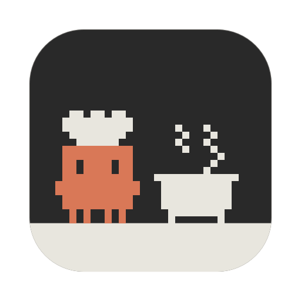

# Design

O ponto de partida foi um vídeo do [kindle-claude](https://github.com/guithepc/kindle-claude) rodando num Kindle. O painel daqui copia a ideia geral (mascote no lado escuro, anéis no lado claro) e adapta pra um popover de barra de menu, de 475×280 pt.

## Regras herdadas do e-ink

Aqui não tem e-ink, mas o visual de papel ficou:

| O quê | Como |
|---|---|
| Cores | tinta `#292929`, papel `#E8E6DE`, cinza `#8C8C87`, fixas independente do tema do Mac |
| Anéis | 24 segmentos em cápsula, preenchidos em tinta e vazios em tinta a 15% |
| Sprites | escala inteira (5 pt no painel, 1 pt na barra), sem antialias |
| Animação | 1 quadro por segundo, que lembra a atualização lenta do e-ink e gasta pouco |
| Texto | fontes do sistema: SF Mono pros rótulos, SF Rounded pros números |

## A barra de menu

O ícone é uma imagem *template*: o macOS pinta de preto ou branco conforme o tema e o fundo. Por isso o sprite da barra tem um bit por pixel, sem cinza.

O ícone só redesenha quando algo muda (estado, quadro ou %). Parado, não gasta nada. A primeira versão era em SwiftUI (`MenuBarExtra`) e redesenhava a cada meio segundo, com uns 5% de CPU. Em AppKit, com 1 quadro por segundo e cache dos sprites, caiu pra uns 2,5% trabalhando e ~0% parado.

## Os cartões

Os três tamanhos seguem os widgets do macOS (158×158, 345×158 e 345×345 nesta tela) e a mesma divisão do painel: tinta à esquerda ou em cima com o Claudinho, papel com os anéis. Médio e grande medem o espaço que recebem e distribuem a partir dele, porque o macOS muda o tamanho dos widgets por tela e por versão.

O mesmo `Card` desenha o widget nativo (parado, quadro 0) e o Claudinho de mesa (animado). O sprite é um `Shape` do SwiftUI, um retângulo por pixel, porque imagem gerada por código não chega até o widget nativo.

## O ícone

Gerado pelo mesmo sprite, com `./build.sh --icon`: o Claudinho mexendo a sopa no fundo de tinta, com uma faixa de papel embaixo de bancada. O corpo ganha a cor de argila do mascote do Claude Code (`#D97857`), a única cor fora da paleta. Em 16 e 32 px a cena não cabe, então só o Claudinho aparece, maior.



## O Claudinho chef

Grade de 27×16: o Claudinho ocupa as colunas 0–11 e o utensílio as colunas 13–26. 16 linhas cabem certinho na barra de menu com 1 pt por pixel.

| Animação | Quando aparece | Quadro 2 |
|---|---|---|
| Mexendo a sopa | pensando | vapor muda de lado, colher inclina |
| Cortando cebola | `Edit`, `Write`, `MultiEdit`, `NotebookEdit` | faca desce |
| Frigideira | `Bash` | ovo pula |
| Temperando | `Read`, `Grep`, `Glob`, web e o resto | grãos caem |
| Prato pronto | até 90 s depois de terminar | brilhos trocam de lugar |
| Sino com "?" | esperando você | balão balança |
| Sino com "!" | pedindo permissão | balão e sino balançam |
| Cochilando com café | parado há mais de 15 min | Zzz sobe (fica parado na barra) |
| Acabou o gás | sessão ou semana em 100% (passa na frente de todos) | faísca tenta acender a boca e não pega |

Enquanto trabalha, o Claudinho levanta os braços no quadro 2, e de vez em quando pisca.

## Pixel art escrita em texto

Como no kindle-claude, nenhum sprite foi desenhado num editor de imagem. Tudo está em [`Sources/Sprites.swift`](../Sources/Sprites.swift) como texto, onde `#` é pixel aceso e `.` é vazio:

```
..##.##.##..      o chapéu
.##########.
.##########.
..########..
...######...
.##########.      a cabeça
.##########.
.##.####.##.      os olhos (fechados: linha cheia)
.##.####.##.
.##########.
############      os braços (sobem no quadro 2)
############
.##########.
.##########.
..#.#..#.#..      as pernas
..#.#..#.#..
```

Cada utensílio é uma lista de camadas `(desenho, x, y)` carimbadas por cima. Animar é só mudar o `y` da faca ou trocar o desenho do vapor.

Pra regenerar os GIFs e as telas do README:

```sh
./build.sh --preview
```
